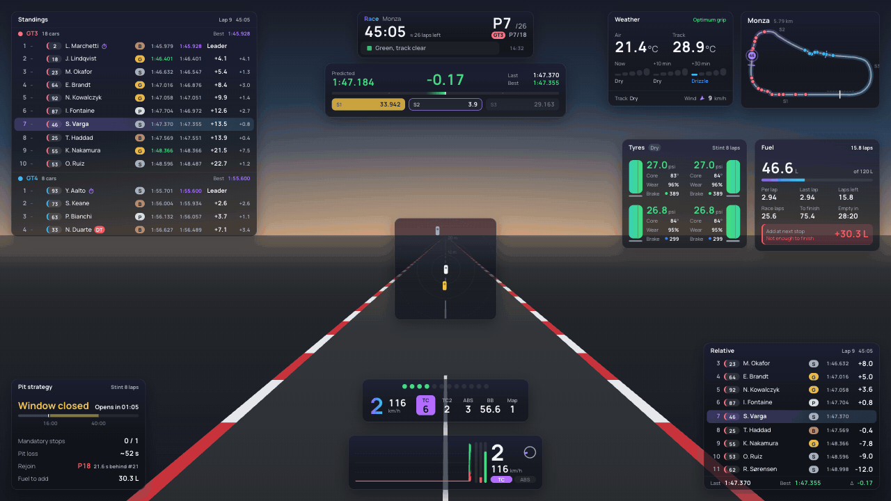
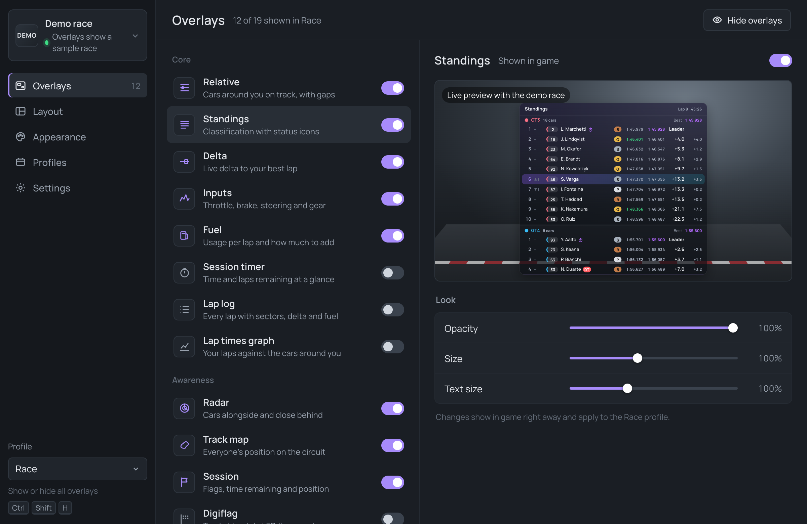

<h1 align="center">OpenSimHUD</h1>

<p align="center">Free, open-source HUD overlays for sim racing.<br>Standings, relative, delta, radar, fuel, tyres and more, drawn over your sim and built to stay light on your frame rate.</p>

<p align="center">
  
  
  
  
  
</p>

<p align="center">
  <a href="https://github.com/marcusfechner/opensimhud/actions/workflows/ci.yml"></a>
  <a href="LICENSE"></a>
  
</p>

<p align="center">
  
</p>
<p align="center"><sub>The built-in demo race with the Race and Practice profiles. In game, the same overlays sit on top of your sim.</sub></p>

> [!NOTE]
> OpenSimHUD is an early preview. Assetto Corsa Competizione works and has been checked against recorded sessions; EVO has player inputs, timing, and spatial overlays after the circuit is learned. There is no release yet.

## Supported games

| Game | Status | How it reads the game |
|---|---|---|
| Assetto Corsa Competizione | Supported | Shared memory for your car, the Broadcasting API for everyone else. The app turns the Broadcasting API on for you. |
| iRacing | Planned | |
| Le Mans Ultimate | Planned | |
| Assetto Corsa EVO | Preview | Shared memory; player inputs, lap timing, fuel, tyres, electronics and session data; spatial overlays use unlabeled opponents after a lap |
| rFactor 2 | Planned | |

Each game is an adapter that fills one shared data model. Overlays hide or adapt to unavailable data; ACC, for example, only reports a tyre's core temperature, not inner, middle and outer.

EVO support is a preview tested against version 0.9.1. Inputs, Clock, Music, Delta, Lap log, Fuel, Tyres, Electronics, Session, Session Timer, and Track map are available. EVO's shared memory does not provide a sector index, so Delta, Lap log, and map markers start with three equal-distance sectors; Touristenfahrten uses one sector. When live EVO is selected, OpenSimHUD reads the game's local log and can learn divisions with 1–10 sectors from at least three clean solo laps after a matching track outline is available. Confirmed boundaries are saved per track configuration and used from the next session; they do not change during the session that taught them. The Track map, Minimap, Radar, Blind spot, and Flat map need a learned track outline; on a new circuit, OpenSimHUD learns it after a completed lap. These overlays show anonymous opponent positions, since EVO does not provide verified identities. EVO also does not provide opponent lap times or tyre wear, so Relative and Standings remain unavailable. Choose ACC, EVO or automatic detection in the game menu. Automatic detection keeps the connected game until it disconnects and prefers ACC if both are available. `OPENSIMHUD_SOURCE=evo` selects EVO explicitly for development.

## Overlays

| | Overlay | What it shows |
|---|---|---|
| **Race** | Standings | Classification by class, with gaps, intervals, best laps, pit stops and status icons (fastest lap, in pit, out lap, penalties) |
| | Relative | The cars around you on track, with gaps in seconds, laps up or down |
| | Delta | Live delta to your best lap, predicted lap time, theoretical best, and each sector's time and gain or loss |
| | Session | Flag, time left, position overall and in class, and the time of day in the game or on your PC |
| | Session timer | Time and laps left, with a progress bar |
| | Lap log | Every lap with sectors, delta to your best and fuel used, plus your theoretical best |
| | Lap times graph | Your laps against the cars ahead and behind, with your average |
| **Awareness** | Radar | Cars alongside and close behind |
| | Blind spot | Mirror-style warnings when a car is beside you |
| | Track map | Every car's position on the circuit, with sector flags |
| | Minimap | A zoomed map that turns with your car |
| | Flat map | The lap as one line with every car on it |
| | Digiflag | A trackside-style LED flag panel |
| | Clock | The time on your PC |
| | Music | What's playing in Spotify or any other player, with its cover; play/pause and skip with wheel buttons |
| **Car and strategy** | Inputs | Throttle, brake, steering, gear and speed, with a trace in your colors and length |
| | Electronics | Shift lights that blink on the limiter, gear, speed, TC, ABS, brake bias and engine map, highlighted when changed |
| | Tyre slip angles | Live FL, FR, RL and RR slip-angle traces in degrees, with signed or magnitude display |
| | Handling balance | Rear minus front average tyre slip-angle magnitude over time |
| | Fuel | Use per lap, laps left, fuel to the finish and how much to add |
| | Tyres | Pressures, temperatures, brake temperatures and wear |
| | Weather | Air and track temperature, rain now and forecast, track grip |
| | Pit strategy | Pit window, mandatory stops, pit loss and where you'd rejoin |

## What you get

- **Made to stay out of the way.** All overlays share one transparent, click-through window per display and one render loop. Each overlay updates at its own rate, and only values that changed touch the page.
- **Start small, build in game.** A new install shows one overlay, the throttle and brake trace. Press <kbd>Ctrl</kbd>+<kbd>Shift</kbd>+<kbd>L</kbd> in game to add overlays from a menu, drag them into place, resize them from their corner and close the ones you don't want.
- **Profiles.** Race, Endurance, Qualifying and Practice come ready-made, and you can make your own. Profiles can switch by themselves when a practice, qualifying or race session starts.
- **Place things your way.** Drag overlays in the app or right over the game. They snap to a grid and to each other, and keep to their side of the screen on ultrawide displays.
- **Resize to fit, not zoom.** Resizing changes what an overlay shows instead of blowing it up. A wider inputs trace shows more seconds, a taller standings, relative or lap log shows more rows, and the maps and lap graph get more room. The other overlays scale as a whole.
- **Your look.** Pick an accent color, panel opacity, and each overlay's size, text size and opacity. Some overlays have their own options, like the inputs trace's colors and length.
- **Tyre slip and balance.** Tyre slip angles shows each wheel in degrees. Handling balance is rear minus front average slip-angle magnitude: positive means relatively more rear slip (oversteer tendency), and negative means relatively more front slip (understeer tendency). It is an axle comparison, not a calibrated measure of available grip.
- **Fuel estimates.** The Fuel overlay learns consumption from up to five complete, representative laps and shows the last measured inlap or outlap separately. Before the first complete lap, ACC's unverified game estimate can show approximate consumption and range. Fuel to add includes a half-lap reserve and needs a measured lap. On EVO Touristenfahrten, consumption and range refer only to timed bridge-to-gantry runs, and no session-finish estimate is shown.
- **Demo mode.** Arrange everything against a sample race without starting the game.
- **Music on your wheel.** The Music overlay shows what Spotify or any other player is playing. In **Settings**, assign wheel or button box buttons to play/pause, next and previous; they work while you drive.
- **Multiple displays.** Put each overlay on the display you want.

## Getting started

1. Install OpenSimHUD with the installer from the latest [release](https://github.com/marcusfechner/opensimhud/releases/latest). After that, the app looks for a new version each time it starts and installs it in one click. Builds of every commit are in [CI](https://github.com/marcusfechner/opensimhud/actions/workflows/ci.yml) (artifact `opensimhud-windows-installer`).
2. For ACC, open **Settings** in the app and click **Turn on broadcasting**, then restart ACC. Without it, only your own car shows. EVO needs no broadcasting setup.
3. Run the game in borderless windowed mode. No overlay can draw over exclusive fullscreen.
4. Start a session. You'll see the throttle and brake trace. Press <kbd>Ctrl</kbd>+<kbd>Shift</kbd>+<kbd>L</kbd> to add, move and close overlays, <kbd>Esc</kbd> when done. Or pick a ready-made profile like **Race** in the app.

| Hotkey | Does |
|---|---|
| <kbd>Ctrl</kbd>+<kbd>Shift</kbd>+<kbd>H</kbd> | Show or hide all overlays |
| <kbd>Ctrl</kbd>+<kbd>Shift</kbd>+<kbd>L</kbd> | Edit the layout in game: add, move, resize and close overlays |
| <kbd>Esc</kbd> | Finish editing |

<p align="center"></p>

Settings are saved to `config.json` in the app's config folder (`%APPDATA%\io.github.marcusfechner.opensimhud` on Windows). Positions are stored for a 1920 × 1080 screen and scaled to yours.

## Development

You need Rust (via [rustup](https://rustup.rs)) and Node.js 22 or newer. Tauri's [prerequisites](https://tauri.app/start/prerequisites/) cover the rest. On Windows, that's WebView2, which is already installed on Windows 10 and 11.

```sh
cd app
npm install
npm run tauri dev        # run the app with hot reload
cargo test --workspace   # from the repo root: Rust tests
```

To work in a normal browser, run `npm run demo:frames` once to record a minute of the demo race, then `npm run dev`:

- `http://localhost:1420/` is the settings window.
- `http://localhost:1420/overlay.html` is an overlay window. `?profile=Race`, `?only=relative` and `?skip=20` choose what you see.

Outside the app, the settings are kept in the browser and shared between tabs. With both pages open side by side, a change in one shows in the other.

To record the README animation, open `overlay.html?profile=Race&bg=track` (then `profile=Practice`); `bg=track` draws a stylized road behind the overlays.

## Recording ACC sessions

Real sessions are recorded on Windows and can be replayed anywhere, so most ACC work can happen on any OS. A recording (`.ovrec`) holds ACC's raw data: shared memory and the Broadcasting API.

For EVO interface research, see [the telemetry notes](docs/evo-telemetry.md). EVO can be recorded as raw versioned JSONL and replayed with `ovtool` or the app:

```powershell
cargo run -p ovtool -- evo-record evo-session.jsonl  # start a driving session first; Ctrl+C stops
cargo run -p ovtool -- replay evo-session.jsonl
$env:OPENSIMHUD_SOURCE = 'replay:evo-session.jsonl'
```

The app replay source is selected before starting `npm run tauri dev`. Recordings may contain driver and session information; review them before sharing.

On the Windows PC with ACC (needs [Rust](https://rustup.rs) and this repository):

```powershell
cargo build --release -p ovtool
.\target\release\ovtool setup              # is ACC's Broadcasting API on?
.\target\release\ovtool setup --enable     # if not: turn it on, then restart ACC
.\target\release\ovtool record             # start ACC, drive, press Ctrl+C when done
```

`record` prints one line of live values every second: lap, gear, speed, fuel, TC, ABS, brake bias and the number of cars from the broadcast. Compare them with the game's own HUD; a mismatch means the data is being read wrong. Good first recordings:

- a practice session of a few clean laps, so the track map can be learned
- a race with other cars and a pit stop
- a session in the rain, if you can

Back on any machine:

```sh
cargo run -p ovtool -- replay acc-2026-10-18-2015.ovrec            # summary and lap log
cargo run -p ovtool -- replay acc-….ovrec --frames > app/public/dev/demo-frames.jsonl
```

The second line replaces the browser preview's demo race with the recording. To check the decoding itself, `cargo run --release -p telemetry --example probe -- FILE [SECONDS]` prints the raw shared memory and broadcast values every few seconds, plus every lap, validity and flag change. The app can also play it directly with `OPENSIMHUD_SOURCE=replay:/path/to/file.ovrec npm run tauri dev`.

## Releasing

```sh
./scripts/release.sh 0.2.0
```

This sets the version in `Cargo.toml`, commits, tags `v0.2.0` and pushes. The [Release workflow](.github/workflows/release.yml) then builds the Windows installer, signs it and publishes it with `latest.json`, which installed apps check for updates.

The app only installs updates signed with the private key whose public half is in `app/src-tauri/tauri.conf.json`. CI reads the key from the `TAURI_SIGNING_PRIVATE_KEY` and `TAURI_SIGNING_PRIVATE_KEY_PASSWORD` secrets. If the key is lost, installed apps can't update anymore and have to be reinstalled by hand, so keep a backup.

## License

GPL-3.0-or-later, see [LICENSE](LICENSE). OpenSimHUD isn't affiliated with Kunos Simulazioni or any other game developer.

## Mockups

`mockups/` holds clickable HTML mockups of every overlay and of the app window. You don't need a build step or a server. Open the files straight from disk:

- `mockups/index.html` is the gallery. It shows every overlay over a stand-in game screen ("In game", with a Race and a Practice example screen) or as individual cards ("All overlays"). You can pause or speed up the fake race.
- `mockups/overlay.html?o=relative&bg=transparent` opens one overlay on its own, the way it will sit in its own window. `bg` can be `transparent`, `checker` or `scene`, and `scale` resizes the overlay.
- `mockups/app.html` is the settings and launcher window.

### Structure

| Path | Purpose |
|---|---|
| `shared/tokens.css` | Design tokens for the one visual style. Users customize the look (accent color, panel opacity) by overriding tokens. |
| `shared/base.css` | Panel, row, badge and bar primitives that only use tokens. |
| `shared/hud.js` | Overlay registry, the single render loop (each overlay sets its update rate), `HUD.restyle()` for runtime token changes, and DOM helpers. |
| `shared/mock-session.js` | Fake race that fills the normalized telemetry model (`HUD.state`). This model is the contract the real game adapters will provide. |
| `shared/fmt.js` | Formatting for lap times, gaps and deltas. |
| `overlays/<id>.js/.css` | One overlay each. Registered with `HUD.register(id, { w, hz, mount })`. |

### Performance rules the mockups follow

- Each overlay builds its DOM once. Updates only change `textContent`, transforms, classes or `data-*` on cached nodes, and only when a value actually changed.
- Everything that is plotted (inputs trace, radar, track map) is drawn on a canvas. Static layers are cached.
- Animations only use `transform` and `opacity`. `backdrop-filter` is opt-in because it is expensive to draw over a game.
